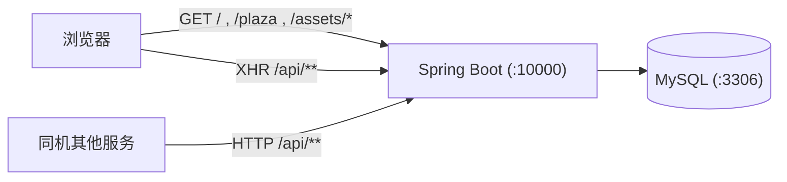

# Bamboohub 轻量化重构与单端口部署设计方案

## 1. 背景与目标

当前项目采用前后端分离容器化部署（Nginx 容器 + Spring Boot 容器 + MySQL 容器 + Redis 容器），依赖 Flyway 进行数据库迁移，并带有未完成的 Spring AI MCP Server 半成品代码，工程脚本与外部依赖偏重。本次简化目标如下：

1. **数据库解耦**：移除 Flyway 依赖与配置，改为手动维护单一的全量建库建表 SQL 脚本，新机器执行一次 SQL 即可直接启动后端对接。
2. **移除 Redis 依赖**：去掉外部 Redis 服务及 Spring Cache 缓存层，消除额外中间件运维负担（同时顺带修复原缓存设计中按 ID 缓存跳过 Token 鉴权的隐患）。
3. **移除半成品 MCP 模块**：清理未写完的 Spring AI MCP Server 依赖、配置类与工具注解，显著减小编译后的 JAR 包体积并消除路由干扰。
4. **去 Docker 化**：清理所有 Docker、Docker Compose、Nginx 代理及镜像导出导入脚本，仅保留一个统一的一键编译打包脚本 `build.sh`。
5. **前后端单端口合体托管**：由 Spring Boot 直接托管前端编译产物，复用同一个端口（默认 `10000`）：
   - 浏览器访问 `/` 及前端路由（如 `/plaza`、`/reading/1`）返回前端 SPA 页面；
   - 访问 `/api/**` 走后端业务接口（前端通过相对路径 `/api` 调用，本机其他服务也可通过 `http://localhost:10000/api/...` 直接调用）。



---

## 2. 模块一：移除 Flyway 并独立维护初始化 SQL

### 2.1 依赖与配置清理
1. **修改 `bbh-back/pom.xml`**：
   - 移除 `org.flywaydb:flyway-core` 与 `org.flywaydb:flyway-mysql` 依赖，以及注释掉的 `flyway-maven-plugin` 配置。
2. **修改 `bbh-back/src/main/resources/application.properties`**：
   - 删除 `spring.flyway.*` 相关配置。
   - 删除无用的 `spring.datasource.initialize=false`（Spring Boot 3 已废弃）。
   - 显式设置 `spring.jpa.hibernate.ddl-auto=none`（或 `validate`），确保 Hibernate 不会自动篡改手动管理的表结构，实现应用与数据库表结构的彻底解耦。
   - 删除 Docker 专用的 `bbh-back/src/main/resources/application-prod.properties`。
3. **删除旧迁移目录**：
   - 移除 `bbh-back/src/main/resources/db/migration/` 下的全部历史迁移碎片文件（`V1__Initial_schema.sql`、`V2__Book_scope.sql`、`init.sql`、`init/` 目录）。

### 2.2 独立维护全量 SQL 脚本（`sql/schema.sql`）
在项目根目录新建 `sql/schema.sql`，将原先 `init.sql` + `V1` + `V2` 的多次 `ALTER TABLE` 演进逻辑合并为**最终态的干净建表语句**，并补齐 JPA 实体约束：

- **包含内容**：
  1. 数据库与用户初始化语句（`CREATE DATABASE IF NOT EXISTS bamboohub`、默认账号授权说明）。
  2. 6 张核心表的最终结构定义（`user`、`book`、`paragraph`、`role`、`para_role`、`follow`），直接采用最终字段（如 `book.scope` 直接定义为 `ENUM('ALLEDIT', 'ALLREAD', 'ALLSEARCH', 'PRIVATE') NOT NULL DEFAULT 'ALLSEARCH'`，直接包含 `end_para_id`，不再出现废弃字段 `is_public`；所有 `create_time` 统一为 `TIMESTAMP NOT NULL DEFAULT CURRENT_TIMESTAMP`）。
  3. **修正历史遗留差异**：`User.java` 中 `@Column(name="username", nullable=false, unique=true)` 声明了唯一约束，而旧 `V1` 脚本漏掉了 `UNIQUE KEY`，新脚本在 `user(username)` 上补齐唯一索引；同时去除旧导出脚本残留的 `AUTO_INCREMENT = 13/87/9` 初始偏移。
  4. 完整的外键约束（`book` ↔ `paragraph` 双向引用通过 `SET FOREIGN_KEY_CHECKS=0` 平滑建表，其余级联删除外键保持不变）。

- **新机器初始化方式**：
  ```bash
  mysql -u root -p < sql/schema.sql
  ```

---

## 3. 模块二：移除 Redis 与缓存层

经排查，项目中 Redis **仅用于 Spring Cache 业务数据缓存**（JWT 为无状态签名，登录态并未存储在 Redis 中）。而且原代码在 `getBookById(token, id)`、`getParagraphsByBookId(token, bookId)` 等带权限校验的方法上仅以 `id`/`bookId` 作为缓存 Key，一旦命中缓存还会跳过方法体内的 `roleUtil` 权限检查。直接彻底移除缓存层不仅省去了外部 Redis 进程，还能消除这一权限隐患、大幅精简 Service 代码。

### 3.1 依赖与配置清理
1. **修改 `bbh-back/pom.xml`**：
   - 移除 `org.springframework.boot:spring-boot-starter-data-redis` 依赖。
2. **修改 `bbh-back/src/main/resources/application.properties`**：
   - 删除 `spring.data.redis.host`、`spring.data.redis.port`、`#spring.cache.type=none` 以及 `logging.level.org.springframework.cache=DEBUG`。

### 3.2 缓存代码清理
1. **删除专属缓存类（共 3 个文件）**：
   - `bbh-back/src/main/java/com/huex/bamboohub/config/CacheConfig.java`（`RedisCacheManager` 配置）
   - `bbh-back/src/main/java/com/huex/bamboohub/util/CacheUtil.java`（手动清理 Cache 工具类）
   - `bbh-back/src/main/java/com/huex/bamboohub/service/UserServiceCache.java`（该类唯一注入点在 `UserServiceImpl`，但实际未被调用，属于冗余死代码）
2. **移除注解与调用点**：
   - `BamboohubApplication.java`：移除 `@EnableCaching` 注解及对应 import。
   - `BookServiceImpl.java`、`ParagraphServiceImpl.java`、`UserServiceImpl.java`、`RoleServiceImpl.java`、`ParaRoleServiceImpl.java`：
     - 移除 `@CacheConfig`、`@Cacheable`、`@CacheEvict`、`@CachePut` 等全部注解；
     - 移除 `@Autowired private CacheUtil cacheUtil`（及 `UserServiceImpl` 中的 `userServiceCache`）；
     - 移除所有 `cacheUtil.clearCache(...)` 以及 `ParagraphServiceImpl` 中的 `evictCacheParas(...)`、`evictCacheParasOfBook(...)` 辅助方法。
   - `BookRepo.java`、`RoleController.java`：移除未使用的 `org.springframework.cache.annotation.*` import。

---

## 4. 模块三：移除半成品 MCP Server 功能

经全量检索，项目中未完成的 MCP 功能仅涉及以下 4 处，清理后可彻底去掉 `spring-ai` 及其庞大的传递依赖（`antlr`、`jtokkit`、`jsonschema-generator`、`swagger` 等），同时也消除了单端口静态托管时 `/mcp` SSE 端点的路由干扰：

1. **修改 `bbh-back/pom.xml`**：
   - 移除 `<spring-ai.version>1.0.0</spring-ai.version>` 属性；
   - 移除 `spring-ai-starter-mcp-server` 与 `spring-ai-starter-mcp-server-webmvc` 两个依赖；
   - 移除整个 `<dependencyManagement>` 中的 `spring-ai-bom`。
2. **修改 `bbh-back/src/main/resources/application.properties`**：
   - 删除末尾 5 行 `spring.ai.mcp.server.*` 配置。
3. **删除 `bbh-back/src/main/java/com/huex/bamboohub/config/McpConfig.java`**：
   - 删除 `ToolCallbackProvider` 注册配置类。
4. **修改 `bbh-back/src/main/java/com/huex/bamboohub/service/BookServiceImpl.java`**：
   - 移除 `getALLREADAndALLEDITBooksWithRole` 方法上的 `@Tool(name="getPlazaBooks", ...)` 注解及 `import org.springframework.ai.tool.annotation.Tool;`。

---

## 5. 模块四：后端单端口托管前端与 `/api` 路由设计

### 5.1 核心问题分析（现状痛点）
目前 `bbh-back/src/main/resources/application.properties` 配置了：
```properties
server.servlet.context-path=/api
```
如果保留 `server.servlet.context-path=/api`，整个 Tomcat Servlet 容器的根路径都会被锁死在 `/api` 下——这会导致静态资源只能通过 `http://localhost:10000/api/index.html` 访问，而浏览器直接访问根路径 `http://localhost:10000/` 会直接返回 404，无法满足“直接访问端口即是前端，`/api` 代表后端”的需求。

同时，前端使用了 `react-router-dom` 的 `BrowserRouter`（包含 `/plaza`、`/bookshelf`、`/reading/:bookId` 等客户端路由），当用户在 `/plaza` 页面刷新浏览器时，请求会发往后端，后端若无 SPA 回退机制会返回 404。

### 5.2 路由与托管架构设计

#### 1. 移除 Servlet `context-path`，改为对 `@RestController` 统一挂载 `/api` 前缀
- **修改 `application.properties`**：
  删除 `server.servlet.context-path=/api`，让 Spring Boot 监听在根路径 `/`（端口保持 `server.port=10000`）。
- **修改 `WebConfig.java`**：
  通过 Spring MVC 原生提供的 `PathMatchConfigurer`，为所有带 `@RestController` 注解的业务控制器自动添加 `/api` 前缀，**无需逐个修改 6 个 Controller 文件中的几十个 `@GetMapping`/`@PostMapping`**：
  ```java
  @Override
  public void configurePathMatch(PathMatchConfigurer configurer) {
      configurer.addPathPrefix("/api",
          HandlerTypePredicate.forAnnotation(RestController.class)
              .and(HandlerTypePredicate.forBasePackage("com.huex.bamboohub.controller")));
  }
  ```
  - 这样 `BookController` 的 `@GetMapping("books/plaza")` 会自动映射为 `/api/books/plaza`，与原先外部调用路径 **100% 兼容**。

#### 2. 静态资源托管与 SPA 路由回退（Fallback）
Spring Boot 默认会自动将 `classpath:/static/` 下的文件映射到根路径 `/`（如 `/index.html`、`/assets/*.js`、`/ken.png`）。针对 `BrowserRouter` 刷新 404 问题，在 `WebConfig.java` 中为静态资源处理器配置自定义 `PathResourceResolver`：

```java
@Override
public void addResourceHandlers(ResourceHandlerRegistry registry) {
    registry.addResourceHandler("/**")
        .addResourceLocations("classpath:/static/")
        .resourceChain(true)
        .addResolver(new PathResourceResolver() {
            @Override
            protected Resource getResource(String resourcePath, Resource location) throws IOException {
                // 避免拦截未匹配的 /api/** 请求，让其正常返回后端 404
                if (resourcePath.startsWith("api/") || resourcePath.equals("api")) {
                    return null;
                }
                Resource requestedResource = location.createRelative(resourcePath);
                // 若存在真实静态文件（如 assets/index-xxx.js、ken.png）则直接返回，否则回退到 index.html 交给 React Router
                return (requestedResource.exists() && requestedResource.isReadable())
                        ? requestedResource
                        : new ClassPathResource("/static/index.html");
            }
        });
}
```

请求分流效果如下：
- `GET http://ip:10000/` -> 返回 `static/index.html`
- `GET http://ip:10000/assets/index-xxx.js` -> 返回对应 JS/CSS/图片静态文件
- `GET http://ip:10000/reading/12`（浏览器直连或刷新） -> 静态文件不存在且非 `/api` 开头，自动返回 `static/index.html`，前端 React Router 渲染对应阅读页
- `GET/POST http://ip:10000/api/**` -> 命中 `@RestController` 后端接口（若接口路径写错，正常返回 404 JSON，不会误返回 `index.html`）
- 同机其他服务调用 -> 直接请求 `http://127.0.0.1:10000/api/...` 即可（`server.address` 默认绑定 `0.0.0.0`，外部浏览器与本机回环均可访问，`WebConfig` 中的 CORS 配置也可保留以兼容调试场景）。

#### 3. 前端 API 客户端改造
1. **修改 `bbh-front/src/api/client.ts`**：
   将原先硬编码的公网 IP `baseURL: 'http://106.13.161.72:10000/api'` 改为同源相对路径（支持环境变量覆盖以便本地 `vite` 开发调试）：
   ```ts
   const instance = axios.create({
       baseURL: import.meta.env.VITE_API_BASE_URL || '/api',
       timeout: 10000,
   });
   ```
2. **修改 `bbh-front/vite.config.ts`**：
   清理掉原先不规范的 `define: { 'import.meta.env.VITE_API_BASE_URL': ... }`，并补充开发态 `server.proxy`，这样平时单独运行 `npm run dev` 时也能无缝代理到本机 `localhost:10000`：
   ```ts
   export default defineConfig({
     plugins: [react(), tailwindcss()],
     server: {
       proxy: {
         '/api': {
           target: 'http://localhost:10000',
           changeOrigin: true,
         },
       },
     },
   })
   ```
3. **统一前端个别漏写斜杠的相对请求路径（防御性规范）**：
   `ParaForm.tsx` 和 `ParaRead.tsx` 中有几处写成了 `'paragraph/...'`（未带前导 `/`），顺手统一为 `'/paragraph/...'`。

---

## 6. 模块五：移除 Docker 与冗余脚本，收敛为单一编译脚本

### 6.1 待清理文件清单
清理项目中所有与容器化、Nginx 证书及旧远程上传硬编码相关的文件：

| 类别 | 待删除文件 / 目录 |
| :--- | :--- |
| Docker 编排与镜像脚本 | `docker-compose.yml`、`docker-compose-image.yml`、`docker-compose.sh`、`export_images.sh`、`import_images.sh`、`rebuild_back.sh`、`rebuild_front.sh`、`rebuild_mysql.sh` |
| 前后端 Dockerfile | `bbh-back/Dockerfile`、`bbh-back/Dockerfile2`、`bbh-front/Dockerfile` |
| Nginx 配置与旧证书 | `bbh-front/nginx/`（整个目录，含旧 IP 自签名证书与 `bbh-front.conf`） |
| 零散子脚本与冗余杂项 | `compile_back.sh`、`compile_front.sh`、`bbh-back/upload.sh`、`bbh-front/upload.sh`、根目录空的/冗余的 `package-lock.json`、`bbh-back/src/main/java/com/huex/bamboohub/prompts.txt`（可选清理早期提示词草稿） |

### 6.2 统一编译脚本设计（`build.sh`）
根目录只保留一个 `build.sh`，串联**前端构建 -> 静态资源拷贝至后端资源目录 -> 后端 Maven 打包**完整流水线：

```bash
#!/usr/bin/env bash
set -euo pipefail

ROOT_DIR="$(cd "$(dirname "$0")" && pwd)"
STATIC_DIR="$ROOT_DIR/bbh-back/src/main/resources/static"

echo "==> [1/3] 编译前端静态资源..."
cd "$ROOT_DIR/bbh-front"
npm install
npm run build

echo "==> [2/3] 同步前端产物至后端 static 目录..."
rm -rf "$STATIC_DIR"
mkdir -p "$STATIC_DIR"
cp -r "$ROOT_DIR/bbh-front/dist/"* "$STATIC_DIR/"

echo "==> [3/3] 编译打包后端可执行 JAR..."
cd "$ROOT_DIR/bbh-back"
if [ -d "/opt/homebrew/opt/openjdk/libexec/openjdk.jdk/Contents/Home" ]; then
  export JAVA_HOME="/opt/homebrew/opt/openjdk/libexec/openjdk.jdk/Contents/Home"
elif [ -x /usr/libexec/java_home ]; then
  export JAVA_HOME="$(/usr/libexec/java_home -v 21+)"
fi
./mvnw clean package -DskipTests

echo "==> 构建完成！产物路径: bbh-back/target/bbh-back-0.2.jar"
echo "==> 运行命令: java -jar bbh-back/target/bbh-back-0.2.jar"
```

---

## 7. 新机器完整部署流程（改造后）

改造完成后，外部环境依赖只剩 **JDK 21+ + MySQL 8**（不再需要 Docker、Nginx、Redis），拿到新机器部署只需 3 步：

1. **初始化数据库**（仅首次执行）：
   ```bash
   mysql -u root -p < sql/schema.sql
   ```
2. **编译打包**（可在开发机编译好直接拷走单个 `.jar`，也可在目标机执行）：
   ```bash
   sh build.sh
   ```
3. **启动单端口服务**：
   ```bash
   java -jar bbh-back/target/bbh-back-0.2.jar
   ```

---

## 8. 分阶段实施与 Commit 规划（共 5 个阶段）

为保证每次提交职责单一、边界清晰，且**每一个 Commit 之后代码都能独立通过编译**，规划为以下 5 个阶段：

### Stage 1：移除半成品 MCP Server 功能
- **Commit Message 建议**：`refactor(back): remove unfinished spring-ai mcp server module`
- **为什么放第一步**：改动极小且完全独立（仅 4 个文件），先拔掉未完成的 `spring-ai` 重型依赖，后续编译验证更快，也不会干扰单端口路由改造。
- **修改范围**：
  - **修改**：`bbh-back/pom.xml`（移除 `spring-ai.version`、`spring-ai-starter-mcp-server*` 依赖及 `spring-ai-bom`）
  - **修改**：`bbh-back/src/main/resources/application.properties`（移除末尾 `spring.ai.mcp.server.*` 配置）
  - **修改**：`bbh-back/src/main/java/com/huex/bamboohub/service/BookServiceImpl.java`（移除 `@Tool` 注解及 import）
  - **删除**：`bbh-back/src/main/java/com/huex/bamboohub/config/McpConfig.java`
- **阶段验收标准**：`cd bbh-back && ./mvnw test-compile` 编译通过。

### Stage 2：移除 Flyway 并提取独立建表脚本
- **Commit Message 建议**：`refactor(db): remove flyway and add standalone sql schema`
- **修改范围**：
  - **新增**：`sql/schema.sql`（合并整理后的全量建库建表脚本，补齐 `user.username` 唯一约束）
  - **修改**：`bbh-back/pom.xml`（移除 `flyway-core`、`flyway-mysql` 依赖及注释插件）
  - **修改**：`bbh-back/src/main/resources/application.properties`（移除 `spring.flyway.*` 与废弃的 `spring.datasource.initialize`，显式声明 `spring.jpa.hibernate.ddl-auto=none`）
  - **删除**：`bbh-back/src/main/resources/db/migration/`（整个目录）
  - **删除**：`bbh-back/src/main/resources/application-prod.properties`
- **阶段验收标准**：`cd bbh-back && ./mvnw test-compile` 编译通过；空 MySQL 实例执行 `mysql < sql/schema.sql` 无报错。

### Stage 3：移除 Redis 依赖与 Spring Cache 缓存层
- **Commit Message 建议**：`refactor(back): remove redis dependency and spring cache layer`
- **修改范围**：
  - **修改**：`bbh-back/pom.xml`（移除 `spring-boot-starter-data-redis`）
  - **修改**：`bbh-back/src/main/resources/application.properties`（移除 `spring.data.redis.*` 及 cache 日志配置）
  - **修改**：`BamboohubApplication.java`（移除 `@EnableCaching`）
  - **修改**：5 个 Service 实现类（`BookServiceImpl.java`、`ParagraphServiceImpl.java`、`UserServiceImpl.java`、`RoleServiceImpl.java`、`ParaRoleServiceImpl.java`）移除 `@Cache*` 注解与 `cacheUtil` 调用；清理 `BookRepo.java`、`RoleController.java` 中未使用的 cache import
  - **删除**：`CacheConfig.java`、`CacheUtil.java`、`UserServiceCache.java`
- **阶段验收标准**：`cd bbh-back && ./mvnw clean package -DskipTests` 打包成功；无需启动 Redis 即可直接运行后端连上 MySQL。

### Stage 4：前后端单端口合体托管与 `/api` 路由改造
- **Commit Message 建议**：`feat(web): serve frontend static assets from backend on single port`
- **修改范围**：
  - **修改**：`bbh-back/src/main/resources/application.properties`（去掉 `server.servlet.context-path=/api`）
  - **修改**：`bbh-back/src/main/java/com/huex/bamboohub/config/WebConfig.java`（增加 `@RestController` 统一 `/api` 前缀映射 + `classpath:/static/` SPA 路由回退解析器）
  - **修改**：`bbh-front/src/api/client.ts`（`baseURL` 改为 `import.meta.env.VITE_API_BASE_URL || '/api'`）
  - **修改**：`bbh-front/vite.config.ts`（移除冗余 `define`，配置开发态 `/api` 代理到 `http://localhost:10000`）
  - **修改**：`bbh-front/src/components/ParaForm.tsx`、`ParaRead.tsx`（规范化漏写前导 `/` 的请求路径）
- **阶段验收标准**：前端 `npm run build` 并将 `dist/*` 拷入 `bbh-back/src/main/resources/static/` 后启动后端，浏览器访问 `http://localhost:10000/`、刷新 `/plaza` 以及调用 `/api/books/plaza` 均正常响应。

### Stage 5：清理 Docker / Nginx 遗留文件并收敛一键编译脚本
- **Commit Message 建议**：`chore(build): remove docker configs and unify build.sh`
- **修改范围**：
  - **重写**：`build.sh`（串联前端构建 -> 拷贝产物至 `static/` -> 后端打包可执行 JAR）
  - **修改**：`.gitignore`（新增忽略 `bbh-back/src/main/resources/static/`、`bbh-front/dist/`、`bbh-back/target/` 等构建产物）
  - **重写**：`README.md`（更新为仅依赖 JDK 17 + MySQL 的极简部署与开发说明）
  - **删除**：
    - `docker-compose.yml`、`docker-compose-image.yml`、`docker-compose.sh`
    - `export_images.sh`、`import_images.sh`、`rebuild_back.sh`、`rebuild_front.sh`、`rebuild_mysql.sh`
    - `compile_back.sh`、`compile_front.sh`、`bbh-back/upload.sh`、`bbh-front/upload.sh`
    - `bbh-back/Dockerfile`、`bbh-back/Dockerfile2`、`bbh-front/Dockerfile`
    - `bbh-front/nginx/`（整个目录）及根目录冗余的 `package-lock.json`
- **阶段验收标准**：在干净工作区直接运行 `sh build.sh`，一步产出包含最新前端静态页面的 `bbh-back/target/bbh-back-0.2.jar`。

---

## 9. 改动文件汇总清单

| 操作 | 路径 | 所属阶段 | 说明 |
| :--- | :--- | :---: | :--- |
| **删除** | `bbh-back/src/main/java/com/huex/bamboohub/config/McpConfig.java` | Stage 1 | 删除 MCP Server 工具注册配置 |
| **新增** | `sql/schema.sql` | Stage 2 | 合并整理后的最终态建库建表 SQL 脚本 |
| **删除** | `bbh-back/src/main/resources/db/migration/**`、`application-prod.properties` | Stage 2 | 移除全部 Flyway 迁移脚本与容器专用配置 |
| **修改** | `bbh-back/pom.xml` | Stage 1~3 | 依次移除 `spring-ai-mcp`（S1）、`flyway-*`（S2）、`data-redis`（S3） |
| **修改** | `bbh-back/src/main/resources/application.properties` | Stage 1~4 | 依次移除 MCP（S1）、Flyway（S2）、Redis（S3）、`context-path=/api`（S4） |
| **修改** | `BamboohubApplication.java` 及 5 个 `*ServiceImpl.java` 等 | Stage 1 & 3 | 移除 `@Tool`（S1）；移除 `@EnableCaching`、所有 `@Cache*` 注解与 `CacheUtil` 调用（S3） |
| **删除** | `CacheConfig.java`、`CacheUtil.java`、`UserServiceCache.java` | Stage 3 | 删除 Redis 缓存配置与辅助类 |
| **修改** | `bbh-back/src/main/java/com/huex/bamboohub/config/WebConfig.java` | Stage 4 | 配置 Controller 统一 `/api` 前缀及静态资源 SPA 回退解析器 |
| **修改** | `bbh-front/src/api/client.ts`、`vite.config.ts`、`Para*.tsx` | Stage 4 | `baseURL` 改为 `'/api'`，增加本地开发 `/api` 代理 |
| **重写** | `build.sh`、`README.md`、`.gitignore` | Stage 5 | 统一编译脚本、忽略 `static/` 构建产物、更新部署文档 |
| **删除** | `docker-compose*.yml`、`*Dockerfile*`、`bbh-front/nginx/` 及各冗余 `.sh` 脚本 | Stage 5 | 彻底清理 Docker 与 Nginx 相关遗留文件 |
